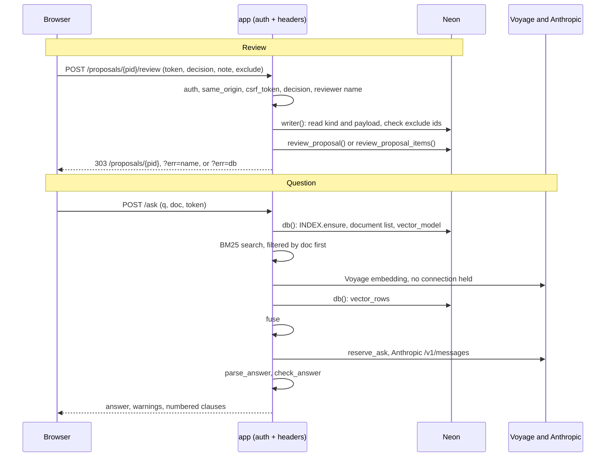

# app package reference

Every function, route, and module-level constant in the `app/` package, in the order they had in the single `app.py` it replaced, with its input, output, and side effects. For known issues, see [README.md](../README.md). For the November review and the status of each finding, see [review-2026-11.md](review-2026-11.md).

Where each part lives. The sections below keep the old single-file order.

- `app/main.py`: the `FastAPI` app, the `security_headers` middleware, `/healthz`, and the routers.
- `app/db.py`: `database_url`, `db`, `writer`.
- `app/security.py`: `auth`, the login throttle, `reviewer_name`, `client_key`, `same_origin`, `csrf_token`.
- `app/templating.py`: the Jinja2 `templates` environment (autoescape on, `StrictUndefined`), the inlined `css`, and the globals and filters the templates use.
- `app/templates/`: `base.html` (page shell and navigation), `_macros.html` (`status_pill`, `counts`, `agent_cell`), and one template per page.
- `app/views.py`: the Python behind the template filters: `mark`, `cite`, `dumps`, `word_diff`, and the `STATUS_VI` and `VERDICT_VI` label tables.
- `app/rules.py`: `FIELDS`, `SECTORS`, `LABEL`, `nice`, `penalty_label`, `OPS_VI`, `rule_text`, `src_label`.
- `app/rag.py`: the BM25 `Index`, `INDEX`, and the Voyage vector search.
- `app/claude.py`: `ask_claude`, the hourly limit, `parse_answer`, `check_answer`.
- `app/routers/`: one module per page group, `documents.py`, `obligations.py`, `runs.py`, `proposals.py`, `ask.py`.

The SQL functions `review_proposal()`, `review_proposal_items()`, `explain_rule()`, and `rule_matches()`, and the tables the app reads, belong to the `oshvn_loader` repository (`migrations/003`–`006`). The app only calls them.

## Request lifecycle

Every request goes through the same three stages.

1. `auth` runs as a global dependency (`FastAPI(dependencies=[Depends(auth)])`). It checks the password for every route except `/healthz`.
2. The route reads the database through `db()`, a read-only connection. Only `record_review` opens `writer()`, and it uses `writer()` only to call the two review functions.
3. The `security_headers` middleware adds `X-Frame-Options: DENY`, `Content-Security-Policy: frame-ancestors 'none'`, and `X-Content-Type-Options: nosniff` to the response, error responses included.

In production the app runs on Render behind Cloudflare, connects to Neon as the role `oshvn_review`, and runs as one process.

## Terms

| Term | Meaning |
|---|---|
| Autoescape | Jinja escapes every `{{ }}` value in the templates. Only `Markup` values skip it: the `mark`, `cite`, and `word_diff` results, which escape the text first, and the inlined `css`. Jinja writes `'` as `&#39;` and `"` as `&#34;`. |
| Client key | The value `client_key` returns: the `CF-Connecting-IP` header, or the socket address when the header is missing. Failed logins are counted per client key. |
| Proposal kind | `documents` (from agent00 or `loader.py propose`) or `obligations` (from agent01). Read as `coalesce(to_jsonb(lp)->>'kind', 'documents')`, so the app also runs on a database without the `kind` column. |
| Proposal status | `pending`, `approved`, `rejected`, `applied`, `superseded`, or `failed`. The app changes only `pending` to `approved` or `rejected`. `loader.py apply` writes approved proposals. |
| CSRF token | `csrf_token(pid)`: the first 32 hex characters of HMAC-SHA256 with key `APP_PASSWORD` over `"proposal:{pid}"`. The `/ask` form uses `csrf_token("ask")`. The token is the same for every user and session. |
| Snapshot | The immutable BM25 index state that `Index` swaps in as one object: `stamp`, `rows`, `tf`, `lens`, `avg`, `idf`. |

## Authentication and infrastructure

**Constants.** `security = HTTPBasic(auto_error=False)`, so a request without credentials gives `None` instead of an automatic 401. `PUBLIC_PATHS = {"/healthz"}`. `LOGIN_FAILURES_ALLOWED = 10` and `LOGIN_WINDOW = 900` seconds. `FAILED_LOGINS` maps a client key to a deque of failure times. `_login_lock` guards it. Both live in process memory.

**`reviewer_name(raw) -> str`**
- Input: the Basic-auth user name, or `None`.
- Output: the name after NFKC normalization, without control (`Cc`), format (`Cf`), and space (`Zs`) characters, without characters named `*FILLER*`, and without BRAILLE PATTERN BLANK, with runs of spaces collapsed. Returns `""` when no letter or digit is left.

**`client_key(request) -> str`**
- Input: the request.
- Output: the `cf-connecting-ip` header, else `request.client.host`, else `"?"`. Cloudflare overwrites `CF-Connecting-IP`, so a client cannot set it. The app does not read `X-Forwarded-For`.

**`auth(request, c) -> str`**
- Input: the request and the optional Basic credentials.
- Output: `""` for `/healthz`, otherwise `reviewer_name(c.username)`.
- Errors: 429 "Sai mật khẩu quá nhiều lần — thử lại sau 15 phút" when the client key has 10 failures in the last 900 seconds. This check runs before the password check. 401 with `WWW-Authenticate: Basic` for a missing or wrong password, or when `APP_PASSWORD` is unset.
- Side effects: drops failure times older than 900 seconds for this client key. Records a failure only when credentials were sent. Deletes the client key's entry on a correct login.

**`app`.** The FastAPI app, with `/docs`, `/redoc`, and `/openapi.json` turned off and `auth` as the global dependency.

**`security_headers(request, call_next)`.** HTTP middleware. Adds the three security headers to every response.

**`database_url() -> str`.** Returns `DATABASE_URL`. Raises 500 "Chưa đặt DATABASE_URL trên Render" when it is unset.

**`db()`.** Context manager. Yields a psycopg connection with `connect_timeout=15` and `read_only=True`, so every transaction starts with `BEGIN READ ONLY`. Rows come back as named tuples, so templates read `r.status`. A SELECT with two unaliased expressions needs `AS` names, or `namedtuple_row` raises on the duplicate name.

**`writer()`.** Context manager. Yields an autocommit connection with `connect_timeout=15`.

## Page shell

**`templates`.** `Jinja2Templates` over `app/templates`. Routes call `templates.TemplateResponse(request, "name.html", context)`. Each page template extends `base.html`, sets `active` to its navigation path, and fills the `title` and `content` blocks. `base.html` holds the six navigation tabs, inlines `css` (read from `app/static/style.css`), and adds the footer note.

**`healthz()`.** `GET /healthz`. Returns `ok` as plain text. Needs no password.

## Documents, search, obligations, and runs

**`documents(request)`.** `GET /`.
- DB: one row per document, `[id, number, type, title_vi, status, parser_version, source_file, n, emb, dieu, pl]`, where `n` counts live legal-article chunks, `emb` counts embeddings, `dieu` counts distinct numeric `locator->>'dieu'`, and `pl` counts appendix chunks. Documents with no chunks sort last. A second query returns the totals `tot` as `[n, dieu, pl]`.
- Output: the document table. The number links to `/doc/{id}` only when `n > 0`. "Khoản và đoạn" shows `n - pl`. Titles are cut at 140 characters. A document without `source_file` shows "dữ liệu mẫu ban đầu".

**`document(request, doc_id: int)`.** `GET /doc/{doc_id}`.
- DB: `legal_documents(number, title_vi, type, check_report)`. When the table `load_proposals` exists, the document proposals for this number as `(id, status, file_name, created_at, reviewed_by, reviewed_at, review_note, verdict, comment, route, report->'chunks')`. The live legal-article chunks `(locator, text)`, ordered with appendices last, then by Điều, khoản, and seq.
- Output: the document page, or 404. Chunks are grouped by `locator["dieu"]`, and each text loses its first line, the heading. The table of contents adds a heading when the Chương changes, and "Phụ lục" for appendix items. Each part is labeled "Khoản N", "Mục N" for appendix items, "Mở đầu" for `kind = lead`, or "Đoạn". `check_report` entries `{ok, name, detail}` show as ĐẠT and LỖI pills. The history table uses the `status_pill`, `counts`, and `agent_cell(full=True)` macros.

**`search(request, q)`.** `GET /search`, with `q` up to 300 characters.
- DB: `websearch_to_tsquery('vi_simple', q)` against `chunks.tsv`, ranked by `ts_rank`, with `ts_headline` snippets marked by `<mark>`. When nothing matches, the query runs again with the words longer than one character joined by `OR`.
- Output: up to 20 hits. The `mark` filter escapes the snippet, and then turns only the exact strings `&lt;mark&gt;` and `&lt;/mark&gt;` back into tags. Each hit links to `/doc/{id}#d{dieu}`.

**`FIELDS`, `SECTORS`, `LABEL`.** The profile fields as `(key, label, type)`, with type `select`, `number`, `role`, or `bool`. The sectors as `code → (name, g36, g37)`, where `g36` and `g37` mark the sectors listed in Điều 36 and Điều 37 khoản 1 of NĐ 39. `LABEL` maps every field key, plus `g36` and `g37`, to its label.

**`nice(reason) -> str`**
- Input: a reason string from `explain_rule`.
- Output: the reason in Vietnamese. Field keys are replaced only at the start of the string. `"contractor"`, `"owner"`, `"none"`, and "applies to every employer" are replaced anywhere. `needs`, `true`, and `false` are replaced as whole words only.

**`penalty_label(p) -> str`.** For a dict, returns `"Đ{dieu} k{khoan}: {text}"`, read with `.get`, and leaves out the khoản part when `khoan` is missing. For anything else, returns `str(p)`.

**`obligations(request)`.** `GET /obligations`.
- Input: query parameters `sector` (default `xd`), `n` (default 350, clamped to 1–10,000,000, 350 when it does not parse), `role` (default `contractor`), and the `bool` fields from `FIELDS` as `1` or absent.
- DB: for every obligation with `sources IS NOT NULL`, `explain_rule(applies_when, profile)` as `[id, topic, kind, duty_vi, action_vi, article_ref, penalties, change_note, ex, reviewed, needs_review, reviewed_by, review_reason]`. A second query counts the old sample obligations with `sources IS NULL`.
- Output: the profile form, the counts of obligations that apply and do not apply, and the table. Applying obligations come first and show `ex.reasons`. The others show `ex.missing`. Tags show "Áp dụng" or "N/A", "đã duyệt bởi …", "cần xem lại" with `review_reason` as its title, and "đã thay đổi". Only the first two penalties show.
- Rules: the checkbox defaults (`strict`, `hazardous`, and `kcn` on) apply only while `n` is absent from the query string. After the first submit, a checkbox is on only when its value is `1`. An `ex` that is not a dict is treated as `{}`.

**`runs(request)`.** `GET /runs`.
- DB: the latest 50 rows of `load_runs` as `[id, kind, status, started_at, created_by, report]`.
- Output: the run table. The detail column shows `report.file`, the `report.chunks` counts read with `.get`, and `report.reason`.

## Proposal review

**`STATUS_VI`.** Status → (Vietnamese label, CSS class).

**`status_pill(status)`.** Macro in `_macros.html`. A pill with the Vietnamese label. An unknown status shows as its own escaped text.

**`counts(c)`.** Macro in `_macros.html`. The string `"N mới / N đổi / N ngừng"` from a chunk-count dict. A value that is not a dict gives zeros.

**`csrf_token(pid) -> str`.** See the CSRF token in [Terms](#terms).

**`word_diff(old, new) -> Markup`.** Splits both texts into word and space tokens and compares them with `difflib.SequenceMatcher(autojunk=False)`. Returns escaped text with removed parts in `<del>` and added parts in `<ins>`.

**`VERDICT_VI`.** agent00 verdict (`ok`, `check`, or `reject`) → (label, CSS class).

**`agent_cell(verdict, comment, route, full=false)`.** Macro in `_macros.html`. A `<td>` with the verdict pill, the route (`ocr` or `parse`), and the comment. Without a verdict, shows "— (tạo bằng loader.py propose)". An unknown verdict shows "?". The comment is cut at 260 characters unless `full` is true.

**`proposals(request)`.** `GET /proposals`.
- DB: up to 100 proposals, pending first, newest first, as 17 named columns, among them `chunks`, `verdict`, `comment`, `route`, `kind`, `n_obligations`, `n_rejected`, and `flagged`.
- Output: the proposal list, or a notice when the table `load_proposals` does not exist. An obligation row shows "N đạt kiểm tra · M bị loại · K có ý không có căn cứ". A document row shows `counts` and `agent_cell`.

**`proposal(request, pid, err="")`.** `GET /proposals/{pid}`.
- Input: the proposal id, and `err` as `name` or `db`. Other `err` values are ignored.
- DB: the proposal kind. For `obligations`, the work moves to `obligation_proposal`. For `documents`, one row `[id, status, doc_code, file_name, options, report, chunks, title, created_at, created_by, reviewed_by, reviewed_at, review_note, apply_report, dtype]` and a check that `legal_documents.number = doc_code` exists.
- Output: the review page, or 404. The page has six panels.
	- Panel 0: the agent00 notes, OCR `number_changes`, `unsure` entries, and up to 60 `low_conf` words.
	- Panel 1: `report.checks`. A check named in `report.accepted` shows "LỖI · chấp nhận".
	- Panel 2: `report.changes`, with `word_diff` for changed text. A key that starts with `PL` is an appendix item. An empty first key marks an old pilot row.
	- Panel 3: `report.issues`.
	- Panel 4: the parsed text from `payload.result.chunks`, grouped by Điều, open by default only for a new document.
	- Panel 5: the decision form while the status is `pending`, otherwise the recorded decision and `apply_report`.
- Rule: whether the document was new comes from the stored `report.document`, not from the database now, so the page reads the same before and after `loader.py apply`.

**`REVIEW_ERRORS`.** The messages for `?err=name` and `?err=db`.

**`same_origin(request) -> bool`.** Takes the `Origin` header, else `Referer`. Returns true only when the value is present and its host equals the `Host` header.

**`review(pid, request, user)`.** `POST /proposals/{pid}/review`, async.
- Input: form fields `token`, `decision` (`approved` or `rejected`), `note` (cut at 2000 characters), and any number of `exclude` values.
- Output: 403 when `same_origin` fails or the token does not match. 400 for any other decision. A 303 redirect to `/proposals/{pid}?err=name` when the reviewer name is empty. Otherwise the result of `record_review`, which runs in `run_in_threadpool`.

**`record_review(pid, decision, user, note, excl)`**
- DB, through `writer()`: reads the proposal kind and payload.
	- For `obligations`: raises 400 when an excluded id is not in `payload.obligations`, listing up to five ids. Otherwise calls `review_proposal_items(pid, decision, user, note, excl)`.
	- For `documents`: raises 400 when `excl` is not empty. Otherwise calls `review_proposal(pid, decision, user, note)`.
- Output: a 303 redirect to `/proposals/{pid}`. A redirect to `?err=db` on any `psycopg.Error`, for example when the proposal is no longer pending.

## Obligation proposals

**`OPS_VI`.** Rule operator → Vietnamese symbol.

**`rule_text(r) -> str`**
- Input: an `applies_when` tree: `{always}`, `{all: [...]}`, `{any: [...]}`, `{not: ...}`, or a leaf `{field, op, value}`.
- Output: the rule in Vietnamese. `always` gives "mọi doanh nghiệp". Branches join with "VÀ" and "HOẶC". A leaf with `= true` gives the field label. A leaf with `= false` gives "không: {label}". Inside `all`, only a child with `any` gets parentheses. A value that is not a dict gives `"?"`.

**`src_label(s) -> str`.** `[doc, dieu, khoan]` → "{doc} Điều {dieu} khoản {khoan}", without the khoản part when `khoan` is `None`.

**`obligation_proposal(request, pid, err)`**
- DB: one row with `payload` (`obligations` and `texts`, keyed `"doc|dieu|khoan"`), `report` (`agent`, `flagged`, `rejected`, `new_fields`, and `log`), the review columns, and `excluded` read through `to_jsonb`.
- Output: the review page for an obligation proposal, or 404. Each obligation shows its id, topic, kind, frequency, content, action, evidence, `rule_text(applies_when)`, `calc`, `change_note`, and penalties.
	- `_verify.unsupported` entries show as errors and give the panel a yellow border. `_verify.inferred` entries show as notes.
	- Each cited source shows its text from `texts`, cut at 2500 characters. `_amended_by` entries show as badges on the amended source, and the amending clause's text is added when the obligation does not cite it.
	- While the proposal is pending, each obligation has an exclude checkbox inside the decision form. Otherwise excluded obligations show "đã loại".
	- The page ends with the drafts that `check()` rejected, the suggested new profile fields, and the agent01 log.

## Hỏi đáp

**`STOP`.** The stopwords, without accents.

**`_norm(t) -> str`.** Lowercases, turns `đ` into `d`, applies NFD, and removes combining marks.

**`_tokens(t) -> list[str]`.** The `[a-z0-9]+` words of `_norm(t)` without stopwords, plus the bigrams `a_b` of all words, stopwords included.

**`Snapshot`, `STAMP_SQL`.** The snapshot type, and the stamp query `count(*), max(id), max(load_run_id)` over live legal-article chunks.

**`Index`.** The in-memory BM25 index, one per process. `INDEX` is the shared instance.
- `ensure(conn)`: reads the stamp and returns when it equals the snapshot's stamp. Otherwise takes the lock, reads the stamp again, loads every live clause `(id, number, locator, text)`, computes term counts, lengths, the average length, and the BM25 idf `ln(1 + (N - n + 0.5) / (n + 0.5))`, and swaps in one new `Snapshot`.
- `search(q, k=12, doc="", k1=1.2, b=0.75) -> list[(score, row)]`: reads the snapshot once. When `doc` is set, skips other documents before scoring. Returns the `k` best rows with a score above 0, best first.

**`vector_model(conn) -> (model, None) | (None, reason)`.** Reads the distinct `chunks.embedding_model` values. Returns the model name without its `voyage:` prefix, or `None` with a Vietnamese reason: no vectors, mixed or non-Voyage models, or `VOYAGE_API_KEY` unset.

**`embed_query(q, model) -> (vector, None) | (None, reason)`.** POSTs to `{VOYAGE_API_BASE}/v1/embeddings` (default `https://api.voyageai.com`) with `input_type = query`, 1024 dimensions, and a 15-second timeout. Any exception gives "Voyage API lỗi (…)". The caller holds no database connection during this call.

**`vector_rows(conn, vec, model, doc="", k=30) -> (rows, mode)`.** Returns rows `(id, number, locator, text, sim)`, where `sim` is 1 minus the pgvector cosine distance, filtered by `doc` in SQL. On `psycopg.Error`, `TypeError`, or `ValueError`, rolls back and returns no rows and the reason.

**`fuse(bm25_hits, vec_rows, k=12) -> list`.** Reciprocal rank fusion with the constant 60, keyed on the document number and the locator. Returns `(score × 1000, row, how)`, where `how` is "từ khóa", "theo nghĩa", or "từ khóa + theo nghĩa".

**`ASK_LOG`, `ASK_LOCK`.** The times of model calls in the last hour, in process memory, and their lock.

**`ask_limit() -> int`.** `ASK_LIMIT_PER_HOUR`, at least 0. Default 60. Returns 60 when the value does not parse.

**`reserve_ask() -> float | None`.** Under the lock, drops call times older than one hour. Returns `None` when the limit is reached. Otherwise records the current time and returns it.

**`release_ask(slot)`.** Removes a recorded call time.

**`_ref(loc, num) -> str`.** "{num} {locator.ref}". Without `ref`, uses `locator.label` or "Điều {dieu}", plus ", khoản {khoan}".

**`_numbers(t) -> list[str]`.** The matches of `\d+(?:[/.,]\d+)*`. A date such as `15/5/2016` and a list such as `5,7` are each one match.

**`_same_number(n) -> str`.** The form used to compare numbers. `1.000.000`, `1,000,000`, and `1000000` give the same form. So do `1,5` and `1.5`.

**`_small_int(x) -> int | None`.** An integer below 10⁶, or a string of at most six ASCII digits as an integer. Returns `None` for booleans and everything else.

**`parse_answer(out) -> dict`.** Returns `{answer: str, used: list[int], not_found: str, _usage}` for any model output. A value that is not a dict gives empty fields. `used` keeps only values that `_small_int` accepts. `_usage` defaults to `("", 0, 0)`.

**`check_answer(answer, used, hits) -> dict`.** Returns `{bad_cite, bad_num, no_cite}`.
- `bad_cite`: cited numbers outside 1 to the number of hits. A citation is a `[n]` marker with up to six digits, or an entry of `used`.
- `bad_num`: numbers in the answer, without citation markers, that do not appear in a cited clause or its reference. A list such as `5,7` passes when every part appears.
- `no_cite`: true when the answer cites nothing.

**`ask_claude(question, hits) -> (dict, None) | (None, error)`**
- Returns the error "Chưa đặt ANTHROPIC_API_KEY …" when the key is unset, without reserving a call. Returns "Đã đủ N câu hỏi trong một giờ …" when `reserve_ask` gives `None`.
- POSTs to `{ASK_API_BASE}/v1/messages` (default `https://api.anthropic.com`) with model `ASK_MODEL` (default `claude-sonnet-5-5`), `max_tokens = 2500`, and a 60-second timeout. The prompt numbers the clauses `[1]`, `[2]`, and so on, with each text cut at 2500 characters, and states the NĐ 283/2026 rule that organisations pay double.
- Parses the `{…}` part of the reply as JSON and adds `_usage = (model, input tokens, output tokens)`.
- Releases the reserved call on an HTTP or network error. Does not release it when the reply is not valid JSON or not a JSON object.

**`doc_numbers(conn) -> list[str]`.** The numbers of documents that have at least one chunk.

**`ask_page(request, q, doc)`.** `GET /ask`. Shows only the form (`ask.html`: `POST /ask` with a hidden `csrf_token("ask")`, a question field of up to 500 characters, and the document list), with `q` and `doc` filled in. It calls no model.

**`ask(request, q, doc, token)`.** `POST /ask`.
- Input: form fields `q` (up to 500 characters), `doc` (up to 40), and `token`.
- Output: 403 when `same_origin` fails or the token does not match. Otherwise the form, the answer panel, and the numbered clauses. The steps run in this order.
	1. In one `db()` block: `INDEX.ensure`, the document list, and `vector_model`.
	2. When `q` is empty: return the form.
	3. `INDEX.search(q, k=40, doc=doc)`.
	4. When a vector model exists: `embed_query` with no connection held, then `vector_rows` in a second `db()` block.
	5. `fuse` the BM25 and vector results, or take the 12 best BM25 rows when there are no vector rows. With no hits, show "Không tìm thấy khoản nào chứa các từ trong câu hỏi." and call no model.
	6. `ask_claude`, then `parse_answer` and `check_answer`.
- The `cite` filter escapes the answer, and then each `[n]` becomes a link to clause `n`. `bad_cite`, `bad_num`, and `no_cite` each show a warning. The answer always shows. Each clause shows its number, a link to `/doc/{id}#d{dieu}`, how it was found, and its text cut at 1800 characters.

## Request flows

## Behavior to know

- Failed logins count only for requests that send credentials. The counts live in one process and reset on every restart. An entry is removed only when the same client key returns, so entries for clients that never return stay in memory.
- The CSRF token does not change per user or session. `same_origin` refuses a POST that has neither `Origin` nor `Referer`.
- A reply from Claude that is not a JSON object still counts against `ASK_LIMIT_PER_HOUR`.
- `INDEX` rebuilds only when the count, the highest id, or the highest `load_run_id` of live clauses changes. A request that triggers the rebuild holds the lock, and concurrent requests wait for it.
- Vector search turns off when the embeddings come from more than one model, or from a model that is not `voyage:*`.
- `/doc/{id}` and `/proposals` check that the table `load_proposals` exists. `/runs` and `/obligations` do not check their tables.
- `check_answer` only warns. It cannot tell a correct number from a correct number attached to the wrong claim.

## Tests

`tests/test_security.py` needs no database. `tests/test_pages.py` starts a throwaway Postgres in Docker from `tests/fixtures/schema.sql` and removes it after the run. Run both from the repository root:

	python -m unittest discover -s tests
